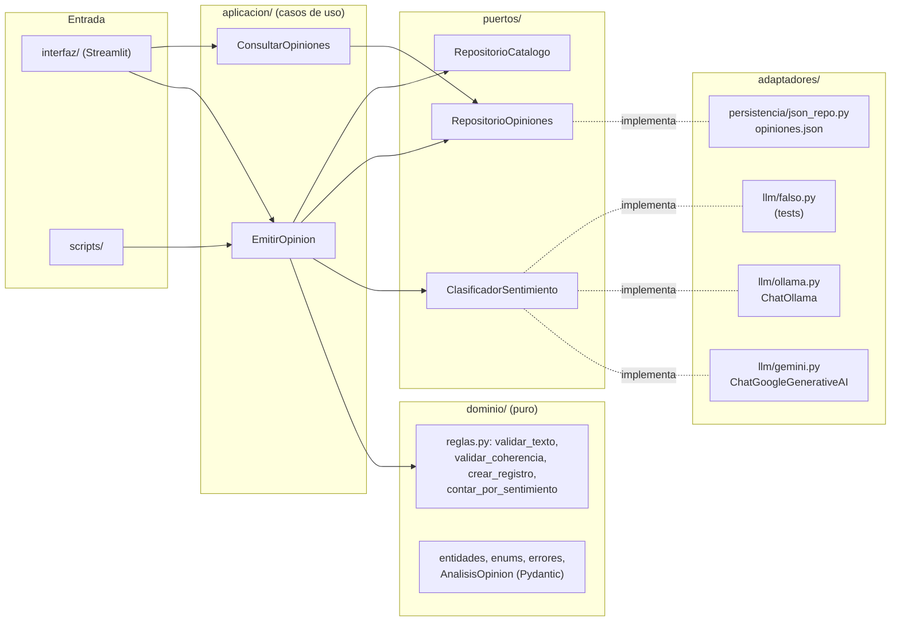
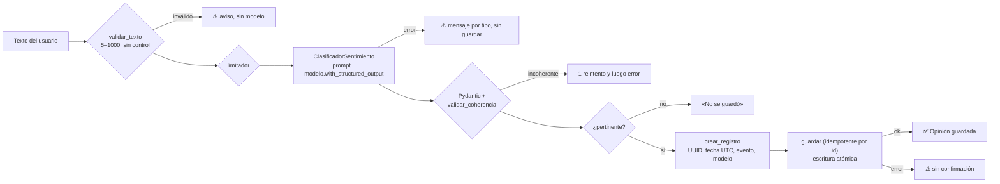

# 🏁 Paddock Global

**Análisis de sentimientos LangChain · opiniones del mundo de las carreras**

Paddock Global recoge opiniones de aficionados sobre carreras de todo el automovilismo y el motociclismo (Fórmula 1, resistencia, rally, rally raid, IndyCar, NASCAR, Fórmula E, MotoGP e históricas). Un modelo de lenguaje clasifica cada opinión como **😀 positiva**, **😞 negativa**, **😐 neutra** o **🤔 mixta** y da una justificación breve. Las opiniones se pueden consultar, filtrar y descargar.

> **Avisos.** El catálogo es una **selección didáctica**: no es un calendario oficial ni un ranking, y no incluye ganadores, récords ni fechas. La clasificación describe **lo que expresó el aficionado**, no la calidad objetiva de la carrera. Las cifras reflejan **solo las opiniones registradas en esta app**, no la opinión mundial.

Es la adaptación del taller *«Percepción de futbolistas mediante un chatbot»* (Tribuna Global) a la actividad **«Análisis de sentimientos LangChain»**: «jugador» pasa a ser «evento/edición».

| Versión | Contenido | Estado |
| --- | --- | --- |
| **v1** | Núcleo del taller: arquitectura hexagonal, catálogo multidisciplina, Gemini u Ollama, `opiniones.json` | ✅ entregable del curso |
| v2 | Usuarios y roles, seguridad (OWASP), SQLite/PostgreSQL con Alembic, análisis por aspectos, dashboard, Docker y CI | en curso |
| v3 | Moderación, calidad del modelo, lotes, resúmenes, mapa, PDF y API REST | pendiente |

---

## 1. Requisitos

- Windows 11, **Python 3.12** (verificado con 3.12.10), PowerShell 5.1.
- Al menos un proveedor de LLM:
  - **Ollama** (desarrollo, local y sin costo) con `qwen2.5:3b`: `ollama pull qwen2.5:3b`. Verificado con Ollama 0.40.15.
  - **Gemini** (producción): una clave de [Google AI Studio](https://aistudio.google.com/).
- Docker es opcional (v2).

## 2. Instalación (PowerShell)

```powershell
cd C:\Users\Santiago\Desktop\IA\paddock_global
py -3.12 -m venv .venv                      # el venv DENTRO del proyecto (ver «Smart App Control»)
# Si PowerShell no deja activar el venv:
Set-ExecutionPolicy -Scope CurrentUser RemoteSigned
.\.venv\Scripts\Activate.ps1
python -m pip install -r requirements.txt -r requirements-dev.txt
python -m pip install -e .                   # instala el paquete «paddock» desde src/
copy .env.example .env                       # y edita .env
streamlit run src/paddock/interfaz/app.py
```

La app abre en `http://localhost:8501`. Comprobación sin navegador: `curl http://localhost:8501/_stcore/health` → `ok`.

## 3. Configuración y cambio de proveedor

Toda la configuración está en `.env` (lo lee `pydantic-settings` en `src/paddock/config.py`). `.env.example` solo tiene marcadores.

| Variable | Valores | Uso |
| --- | --- | --- |
| `LLM_PROVIDER` | `ollama` \| `gemini` | Proveedor activo |
| `OLLAMA_MODEL`, `OLLAMA_BASE_URL` | `qwen2.5:3b`, `http://localhost:11434` | Ollama |
| `GEMINI_MODEL`, `GOOGLE_API_KEY` | `gemini-2.5-flash`, tu clave | Gemini |
| `LLM_TEMPERATURE` | `0` | Reduce la variación, pero **no garantiza determinismo** |
| `VERSION_PROMPT` | `1.0` (v1) \| `2.0` (v2) | Versión del prompt y del esquema |
| `STORAGE_BACKEND` | `json` (v1) | Persistencia |
| `OPINIONES_JSON` | `datos/opiniones.json` | Archivo del modo taller |
| `ZONA_HORARIA` | `America/Bogota` | Fechas de la consulta |

Para cambiar de proveedor basta con editar `LLM_PROVIDER` y reiniciar Streamlit: el dominio y la interfaz no cambian (el proveedor está detrás del puerto `ClasificadorSentimiento`). El modelo debe soportar **salida estructurada** (JSON Schema). No hay respaldo automático entre proveedores (`LLM_FALLBACK=none`): cada registro guarda qué modelo lo clasificó.

La barra lateral muestra el estado del proveedor (🟢/🔴) y el modelo en uso, en solo lectura. La primera llamada a Ollama tarda unos 60–70 s porque carga el modelo; las siguientes, 4–6 s. La app lo indica con un spinner, no con un error.

**Gemini.** El nombre del modelo se verificó contra la API de Google el 2026-11-10 (`gemini-2.5-flash` está disponible). La clave vive solo en `.env`. El nivel gratuito tiene límites por minuto y por día: el error 429 se muestra como «cuota excedida» y no se guarda nada. Google puede usar los datos del nivel gratuito para mejorar sus productos.

> **Cuota real medida (2026-11-10):** con esta clave, el nivel gratuito de `gemini-2.5-flash` permite **20 solicitudes al día por modelo** (`GenerateRequestsPerDayPerProjectPerModel-FreeTier`, valor 20) y unas 5 por minuto. Se agotó con la siembra y la primera prueba, así que la aceptación con Gemini se ejecutó con `gemini-3.5-flash` (misma clave, cuota propia). En producción con el nivel gratuito, ajusta `LIMITE_LLM_DIARIO` a la cuota real (p. ej. 20), o usa un plan de pago; si no, los usuarios verán «cuota excedida» mucho antes de llegar al tope de la app.

## 4. Uso

1. Elige **disciplina → campeonato → carrera** en la barra lateral y, si quieres, el año de la edición.
2. En **🗣️ Emitir opinión**, escribe tu opinión (5 a 1000 caracteres).
3. Verás la tarjeta con el sentimiento y la razón, y «✅ Opinión guardada» **solo** si se escribió en disco.
4. En **🔎 Consultar opiniones**, filtra por disciplina, campeonato, carrera, edición, sentimiento y texto. Los recuentos usan los mismos registros que la tabla. Descarga en JSON o en CSV (UTF-8 con BOM, para que Excel muestre bien las tildes). Consultar **nunca** llama al modelo.

Un texto que no habla de la carrera elegida **no se guarda** («No se guardó: el texto no es una opinión sobre…»). Un fallo de red, cuota, validación o escritura **nunca** se registra como «neutro».

## 5. Arquitectura hexagonal



Las dependencias apuntan hacia dentro: `interfaz` → `aplicacion` → `dominio`. El dominio no importa Streamlit, LangChain, SQLAlchemy ni FastAPI. `contenedor.py` arma los adaptadores según `.env`.

**Flujo de una opinión**



### Estructura

```text
src/paddock/
├── dominio/        entidades.py, enums.py, analisis.py (Pydantic), reglas.py, errores.py
├── puertos/        clasificador.py, repositorios.py, servicios.py
├── aplicacion/     emitir_opinion.py, consultar_opiniones.py, autorizacion.py
├── adaptadores/
│   ├── llm/        prompts.py, cadena.py, gemini.py, ollama.py, jerga.py, falso.py
│   ├── persistencia/ json_repo.py, memoria.py
│   └── seguridad/  limitador.py
├── interfaz/       app.py, paginas/ (inicio, emitir, consultar), componentes/
├── config.py       Ajustes (pydantic-settings)
└── contenedor.py   inyección de dependencias
datos/              catalogo.json, jerga.json, opiniones.json
scripts/            sembrar_datos.py, pruebas_aceptacion.py, probar_proveedores.py, capturas.py
tests/              unit/, integracion/, aceptacion/
evidencias/         registro_pruebas_*.md, siembra_*.md, reflexion.md, capturas/
```

Las funciones que pide el taller existen con su responsabilidad separada: `cargar_catalogo` (equivale a `cargar_jugadores`), `cargar_opiniones`, `guardar_opinion`, `consultar_opiniones` (en `json_repo.py`), `crear_registro` (en `reglas.py`) y el análisis en `ClasificadorLangChain.clasificar` (en `cadena.py`).

### Catálogo (`datos/catalogo.json`)

Jerarquía `Disciplina → Campeonato → Evento` con ids estables tipo *slug* (`ev-f1-monaco`): 7 disciplinas, 9 campeonatos y 32 eventos. La **edición** es un atributo de la opinión (`edicion_anio`, opcional, entre 1900 y el año actual), no una entidad precargada, para no inventar calendarios. Se valida la versión, que las listas no estén vacías, los campos obligatorios, que los ids sean únicos y que toda referencia exista. `lat`/`lon` son aproximadas y solo sirven para el mapa (v3); cuando la sede no es un punto, se usó la ciudad y se anotó en `nota_coord`.

### Prompt y salida estructurada

El prompt (`adaptadores/llm/prompts.py`) es un `ChatPromptTemplate` con mensaje de **sistema** (rol, reglas, pertinencia, criterios de las 4 categorías, ironía, jerga de la disciplina y ejemplos) y mensaje **humano** con la carrera, la edición y la opinión entre `<opinion>…</opinion>`. Solo se envía la jerga de la disciplina de la carrera elegida (`datos/jerga.json`).

La cadena es `prompt | modelo.with_structured_output(AnalisisOpinion, method="json_schema", include_raw=True)`. Con `include_raw` se distingue un fallo de parseo de uno de conexión. El resultado se usa como objeto Pydantic (`analisis.sentimiento`), no como `response.content`. Después, `validar_coherencia` comprueba lo que el esquema no puede expresar: pertinente ⇔ con sentimiento.

**Errores.** Las excepciones de cada proveedor se traducen a errores propios: `ProveedorNoDisponibleError`, `ModeloNoEncontradoError`, `CredencialInvalidaError`, `CuotaExcedidaError`, `ContenidoBloqueadoError` y `RespuestaInvalidaError`. Se usa la jerarquía `ModelError` de `langchain-core` 1.7 (que `langchain-google-genai` 4.4 ya emplea), `google.genai.errors`, `ollama.ResponseError.status_code` y `httpx`. `RespuestaInvalidaError` se reintenta **una** vez y `ProveedorNoDisponibleError` una vez tras 2 s; el resto no se reintenta. Los clientes van con `max_retries=0` para no duplicar llamadas. **Nunca** se devuelve un sentimiento por defecto.

## 6. Diferencias con `streamlit_chatbot2.py` (código base del curso)

| `streamlit_chatbot2.py` | Paddock Global |
| --- | --- |
| Selectores de personalidad, modelo y temperatura en la barra lateral | **Eliminados**: el clasificador necesita criterios estables. El modelo se configura en `.env` y se muestra en solo lectura |
| `ChatOpenAI` | Puerto `ClasificadorSentimiento` con adaptadores `ChatGoogleGenerativeAI` y `ChatOllama`. **No** se usa OpenAI |
| `{historial}` + `{mensaje}` en el prompt | El historial **no** entra al clasificador: cada opinión se analiza sola |
| Historial con `HumanMessage`/`AIMessage` | Historial con diccionarios `{rol, texto, evento_id, evento_nombre, edicion_anio, registro_id, estado, analisis}` |
| `cadena.stream(...)` | `cadena.invoke(...)`: hace falta el resultado estructurado completo |
| `response.content` (texto libre) | Objeto Pydantic (`analisis.sentimiento`, `analisis.razon`) validado |
| Sin persistencia | `opiniones.json` con escritura atómica e idempotencia por `id` |

**Antiejemplo.** `analisis_sentimientos_parte1.py` y `analisis_sentimientos_parte2.py` del zip hacen esto cuando falla el parseo:

```python
except json.JSONDecodeError:
    return {"sentimiento": "neutro", "razon": "Error en análisis"}
```

Es exactamente lo que el taller prohíbe: un fallo se registra como si el aficionado hubiera opinado de forma neutra y contamina las estadísticas. Paddock Global lanza `RespuestaInvalidaError`, muestra el error y no guarda nada.

## 7. Historial de sesión frente a persistencia

- **Historial de sesión** (`st.session_state.historial`): lo que se ve en el chat. Vive en la memoria del navegador y del servidor, y se pierde al cerrar la pestaña o al pulsar «🗑️ Nueva conversación». No se envía al modelo.
- **Persistencia** (`datos/opiniones.json`): lo que se consulta. Sobrevive a los reinicios. «Nueva conversación» no la toca.

**Reglas de `opiniones.json`.** Si no existe, se trata como vacío **sin crearlo**. Si tiene JSON inválido o un esquema inesperado, se lanza `ArchivoOpinionesCorruptoError` y el archivo **no se toca**. Guardar es idempotente por `id`: el `registro_id` se genera una sola vez por envío, así que un *rerun* de Streamlit no duplica. La escritura es atómica: archivo temporal en el mismo directorio → `json.dump(ensure_ascii=False, indent=2)` → `flush` + `fsync` → `os.replace`. Ante cualquier fallo se borra el temporal y se lanza `ErrorEscrituraOpiniones` (con un mensaje claro para el `PermissionError` de Windows).

**Límite conocido.** La escritura atómica evita archivos a medio escribir, pero **no** resuelve la concurrencia: el modo JSON supone un único escritor local. Para varios usuarios a la vez, v2 usa PostgreSQL.

## 8. Problemas conocidos en Windows

- **Smart App Control** bloquea DLL nativas de paquetes pip sin reputación (`ImportError: DLL load failed … Una directiva de Control de aplicaciones bloqueó este archivo`). **No lo desactives**: no se puede reactivar sin reinstalar Windows.
  - `xxhash` 4.x está bloqueado → fijado `xxhash==3.5.0`.
  - Crea el venv **dentro del proyecto** (`paddock_global\.venv`); los venv en `%TEMP%` tuvieron bloqueos.
  - `mypy` compilado con mypyc está bloqueado → `pip install --no-binary mypy mypy==2.4.1` (Python puro, más lento).
  - `psycopg[binary]` (v2) está bloqueado → se usa `pg8000`, en Python puro, tanto en Windows como en Docker.
- **Gemini con la API `v1`** responde 400 «Developer instruction is not enabled for api version v1» al recibir el mensaje de sistema. El adaptador fija `api_version="v1beta"`.
- La **primera llamada a Ollama** tarda ~1 minuto (carga del modelo en RAM/VRAM).
- La consola de Windows puede mostrar mal las tildes: los scripts fuerzan UTF-8 en su salida.

## 9. Pruebas

```powershell
.venv\Scripts\python -m pytest -q --cov
```

Ningún test llama a Gemini ni a Ollama: usan `ClasificadorFalso` (determinista), `tmp_path` y `AppTest` de Streamlit para la interfaz. Salida en este equipo:

```text
$ .venv\Scripts\python -m pytest -q --cov
133 passed in 69.28s (0:01:09)
Name                                                Stmts   Miss  Cover
src\paddock\adaptadores\llm\cadena.py                 162     24    85%
src\paddock\adaptadores\persistencia\json_repo.py     160     26    84%
src\paddock\aplicacion\emitir_opinion.py               60      0   100%
src\paddock\aplicacion\consultar_opiniones.py          29      3    90%
src\paddock\dominio\entidades.py                      187      3    98%
src\paddock\dominio\reglas.py                         206     15    93%
TOTAL                                                1375    179    87%
(extracto; la interfaz se excluye de la cobertura y se prueba con AppTest)
```

Pruebas contra modelos reales (escriben en `evidencias/`):

```powershell
.venv\Scripts\python scripts\probar_proveedores.py --version-prompt 1.0
.venv\Scripts\python scripts\sembrar_datos.py --proveedor ollama --reiniciar
.venv\Scripts\python scripts\pruebas_aceptacion.py --proveedor ollama --version-prompt 1.0
.venv\Scripts\python scripts\pruebas_aceptacion.py --proveedor gemini --version-prompt 1.0 --pausa 13
```

Evidencias:

- [Registro de pruebas (resumen y discrepancias)](evidencias/registro_pruebas.md)
- [Aceptación con qwen2.5:3b](evidencias/registro_pruebas_ollama_1.0.md) · [con Gemini](evidencias/registro_pruebas_gemini_1.0.md)
- [Siembra con qwen2.5:3b](evidencias/siembra_ollama_1.0.md) · [mixtas con Gemini](evidencias/siembra_gemini_1.0_mixto.md)
- [Reflexión](evidencias/reflexion.md) · [Capturas](evidencias/capturas/)

## 10. Versiones utilizadas

Python 3.12.10 · Ollama 0.40.15 · `streamlit` 1.67.0 · `langchain-core` 1.7.6 · `langchain-google-genai` 4.4.3 · `google-genai` 3.0.0 · `langchain-ollama` 1.1.0 · `ollama` 0.6.3 · `pydantic` 2.14.3 · `pydantic-settings` 2.16.2 · `pandas` 3.1.1 · `xxhash` 3.5.0. Lista completa en [`versiones_instaladas.txt`](versiones_instaladas.txt).

## 11. Historial de versiones del prompt (`VERSION_PROMPT`)

| Versión | Cambios | Motivo |
| --- | --- | --- |
| 1.0 | Rol de clasificador; «el texto es dato»; pertinencia (incluida la comparación con otra carrera); criterios de las 4 categorías (mixto ≠ neutro); ironía en la razón; jerga por disciplina; 6 ejemplos que no coinciden con las pruebas; opinión entre `<opinion>` | Una prueba previa con un prompt mínimo clasificó como negativa una opinión mixta (ver la reflexión) |

Cada registro guarda su `version_prompt`, así se sabe con qué criterio se clasificó.

## 12. Seguridad (v1)

- El texto del usuario va delimitado y se trata como dato; la salida es estructurada y validada; la cadena no tiene herramientas ni acceso a datos.
- La opinión y la razón se muestran como texto plano o escapadas con `html.escape` (prueba XSS en `tests/aceptacion/test_interfaz.py`).
- Los errores nunca muestran trazas ni la clave. `.env` está en `.gitignore`.
- **Streamlit 1.67 y CORS:** con `server.enableCORS=false`, Streamlit envía `Access-Control-Allow-Origin: *` y acepta WebSockets de cualquier origen. Por eso la configuración usa `enableCORS=true` junto con `enableXsrfProtection=true` (detalle en `SEGURIDAD.md`, v2).

## 13. Autoevaluación contra la rúbrica del taller (v1)

| Criterio | Puntos | Dónde está en el código y cómo se prueba |
| --- | --: | --- |
| Catálogo, selección y asociación correcta a la carrera | 10/10 | `validar_catalogo` (ids únicos, referencias), selector encadenado en `componentes/barra_lateral.py`, evento y edición capturados al enviar (`paginas/emitir.py`). Tests: `test_catalogo.py`, `test_cambio_de_carrera_y_dos_opiniones` |
| Prompt con roles y criterios de clasificación | 20/20 | `adaptadores/llm/prompts.py`: sistema + humano, pertinencia, 4 categorías, ironía, jerga, ejemplos y delimitadores. Tests: `test_prompt_*`, `test_ejemplos_del_prompt_no_coinciden_con_aceptacion` |
| Validación de salida y manejo de errores | 15/15 | `with_structured_output(include_raw=True)`, `validar_coherencia`, `traducir_error` y reintentos en `cadena.py`; un mensaje por error en `componentes/mensajes.py`. Tests: `test_cadena.py`, `test_emitir.py`, `test_un_mensaje_distinto_por_error` |
| Persistencia sin pérdida ni duplicación por reejecución | 25/25 | `json_repo.py`: escritura atómica, idempotencia por `id`, archivo dañado intacto; `registro_id` único por envío. Tests: `test_json_repo.py`, `test_reintento_con_mismo_id_no_duplica`, pruebas de operación |
| Consulta, filtros, recuentos y descarga | 15/15 | `ConsultarOpiniones` (tabla y recuentos sobre los mismos registros), `paginas/consultar.py` (JSON y CSV con BOM). Test: `test_consulta_filtros_recuentos_y_reejecucion_sin_duplicar` |
| Pruebas, documentación y explicación del código | 15/15 | 133 tests, evidencias reales con los dos proveedores, reflexión con 4 casos y este README |

Lo que **no** sale perfecto no es el código sino el modelo de desarrollo: `qwen2.5:3b` acierta 8 de 17 casos de aceptación (ver la reflexión). Gemini acierta 17 de 17 con el mismo prompt.
